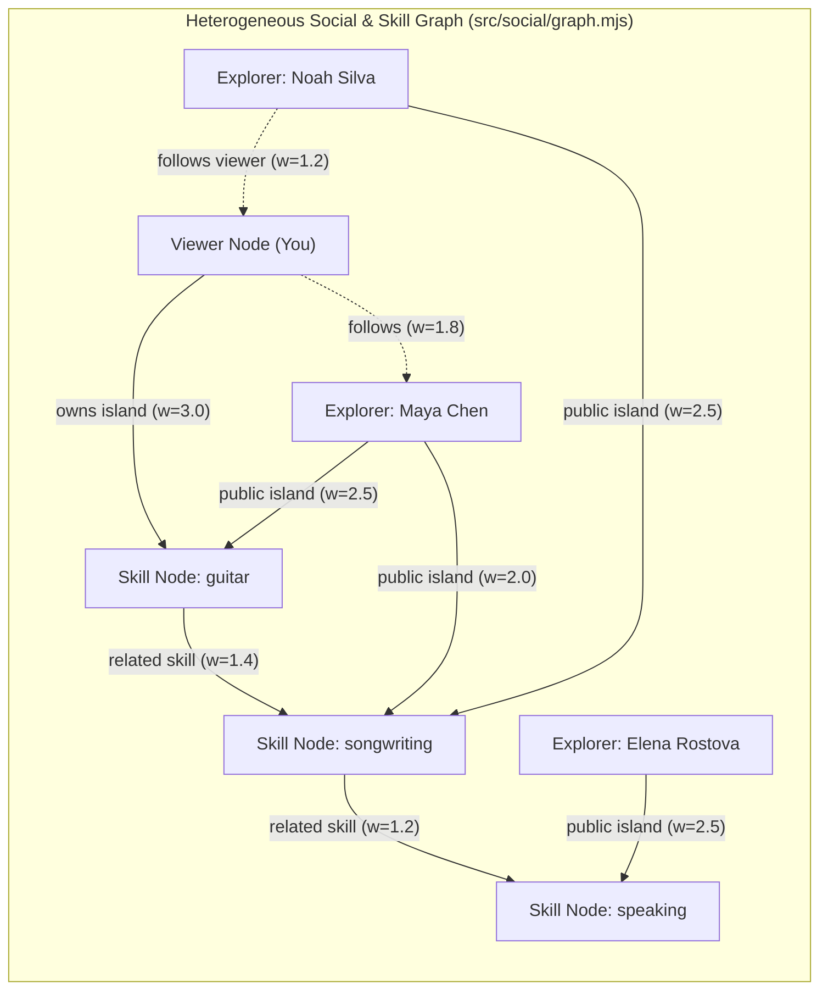

# Graph-Ranked Surrounding Neighbours & Following/Followers Individual Archipelago View

## Goal Description

Upgrade the WorldHopper **Explore** experience (`src/social/**`) with two cohesive capabilities:

1. **Graph-Based Surrounding Neighbours (5–10 Dynamic Neighbours)**:
   - Expand the pool of public/sample explorer profiles in `src/social/fixtures.mjs` to **12 diverse explorers** across guided and custom skills (Guitar, Songwriting, Photography, Japanese, Chess, Public Speaking, Visual Storytelling, Origami, Spanish Travel, Sketching, Trail Running, Synth Production).
   - Build a deterministic **Heterogeneous Skill & Social Graph Algorithm** (`rankNeighborsByGraph` in `src/social/graph.mjs`) that constructs a weighted graph of **Users**, **Skills/Topics**, **Experience Stages**, and **Follow Edges**, and runs **Personalized PageRank (Random Walk with Restart)** combined with **Adamic-Adar shared-skill weighting** seeded from the current user's islands and interests.
   - Select the top **5–10 most relevant neighbours** (default `8`) to surround the user's Home Archipelago on the shared ocean map, placing higher-similarity neighbours in closer radial sectors and displaying their graph affinity score & shortest connection path (e.g., `92% affinity · Guitar → Songwriting`).

2. **Following & Followers Section with Individual Archipelago Map View**:
   - Track both **Following** (`isFollowing`) and **Followers** (`followsViewer` / `followers` list) in `contracts.mjs`, `fixtures.mjs`, and `supabase-client.mjs`.
   - Add a **Following & Followers** section in the Explore UI (accessible both from the top filter/navigation bar and inside the Explorer drawer) listing every user you follow and every user who follows you.
   - Clicking a profile in **Following** or **Followers** (or clicking **"View solo archipelago"** on any cluster) switches the map into **Individual Archipelago Mode** (`mapMode: 'solo'`), rendering **only that explorer's islands** full-scale across the ocean canvas (using `layoutIslands` from `src/map-layout.mjs`) alongside their profile & roadmap drawer, with a one-click **"← Back to neighbourhood ocean"** button to return to the multi-cluster view.

---

## Architecture & Graph Algorithm Design

### How `rankNeighborsByGraph` Works
1. **Nodes**:
   - `user:<id>` for the viewer and each candidate public profile.
   - `skill:<key>` for each canonical skill (`guitar`, `songwriting`, `photography`, `people`, `speaking`, `language`, `visual`, `board`, `origami`, `cooking`, `coding`, `fitness`, `compass`).
2. **Weighted Undirected + Directed Edges**:
   - `user ↔ skill`: weighted by island level and whether it is an active island (`2.0 + 0.35 * level`) or declared profile interest (`1.2`).
   - `skill ↔ skill`: weighted edges between complementary skills (`1.35`) so 2-hop bridges (e.g., `Guitar ↔ Songwriting ↔ Public Speaking`) are naturally discovered even when a user has no exact 1-hop overlap.
   - `user ↔ user`: social tie edges (`1.6` if viewer follows candidate, `1.1` if candidate follows viewer).
3. **Scoring (`Personalized PageRank + Adamic-Adar`)**:
   - Run **Random Walk with Restart (Personalized PageRank)** for `20` power iterations with damping factor $\alpha = 0.82$, teleporting back to `user:viewer` (and the viewer's owned skill nodes) at each step.
   - Combine the stationary PPR probability with **Adamic-Adar similarity** ($\sum_{s \in N(u) \cap N(v)} \frac{1}{\log(1 + \text{deg}(s))}$) so rare shared custom skills (e.g., Origami or Japanese) get a stronger specificity boost than generic tags.
   - Extract the **shortest explainable path** (`viewer → skill → candidate` or `viewer → skillA → skillB → candidate`) to show a human-readable badge on each cluster and in the drawer.

---

## Proposed Changes

### 1. Graph Ranking Engine (`src/social/graph.mjs`)
- Implement `buildInterestGraph(viewerWorld, publicProfiles, options)` creating the adjacency list over `user:*` and `skill:*` nodes.
- Implement `rankNeighborsByGraph(viewerWorld, publicProfiles, { limit = 8, minNeighbors = 5, maxNeighbors = 10, viewerId })`:
  - Computes Personalized PageRank (RWR) + Adamic-Adar similarity.
  - Returns top `limit` (clamped to `5..10`) ranked neighbour entries `{ profile, affinityScore, affinityPercent, pathSummary, sharedSkills, hopCount, ring }`.
  - Assigns each selected neighbour to a spatial ocean sector around the user's Home Archipelago (closer radial distance for higher graph affinity).

### 2. Contracts, Fixtures & Supabase Client (`followsViewer` & Expanded Pool)
- **`src/social/contracts.mjs`**: Update `toPublicProfile(rawProfile, { viewerId, followingIds, followerIds, blockedIds })` to include `followsViewer: Boolean`.
- **`src/social/fixtures.mjs`**: Expand `createDefaultFixtureRecords()` from 5 to **10–12 rich sample explorers** covering Guitar, Songwriting, Photography, Japanese, Chess, Public Speaking, Visual Storytelling, Origami, Spanish Travel, and Urban Sketching. Seed initial `initialFollowingIds` and `initialFollowerIds`.
- **`src/social/supabase-client.mjs`**: Compute `followerIds` (users where `following_id === viewerId`) alongside `followingIds` in `fetchHydratedProfiles()` and pass `followerIds` to `toPublicProfile`.

### 3. Explore Map Modes (Surrounding Graph Neighbours vs. Individual Archipelago) & Following/Followers UI
- **`src/social/explore.mjs`**:
  - Use `rankNeighborsByGraph` to pick the **5–10 surrounding neighbours** for the shared ocean map based on `viewerWorld.islands` and place them in radial sectors around `HOME_CLUSTER_POS` (with affinity badges like `91% match · Guitar`).
  - Add a **Following & Followers** panel/drawer section and top toolbar buttons (`Following (N)` and `Followers (M)`).
  - Add **Individual Archipelago Map Mode (`state.mapMode = 'neighborhood' | 'solo'`)** so clicking a profile in Following or Followers renders **only that user's islands** using `layoutIslands` (`src/map-layout.mjs`), with a **"← Back to neighbourhood"** button.
- **`src/social/social.css`**: Style `.cluster-affinity-badge`, `.social-network-panel`, `.social-person-row`, and `.solo-map-return-btn`.

### 4. Automated Tests (`tests/social.test.mjs`)
- Add unit tests for `rankNeighborsByGraph` (1-hop, 2-hop skill bridges, dynamic re-ranking when viewer islands change, 5–10 neighbour bounds).
- Add UI integration tests for **Following & Followers** and switching between **Individual Archipelago Mode (`solo`)** and **Neighbourhood Mode (`neighborhood`)**.

---

## Review and requested revisions

**Verdict: viable as a fixture-based Explore upgrade.** Keep the shared ocean, the solo archipelago view, and short explanations for why an explorer appears. A small, deterministic ranker can run locally for twelve sample explorers. The current branch mounts the fixture client, so the demo can exercise these features before any Supabase rollout. The proposal needs clearer scoring, layout and visibility rules before it is ready to implement.

### Keep

- Reuse the existing ocean, map camera, island layout, public world lookup and adoption flow. A solo view is a natural way to inspect an explorer without crowding the neighbourhood map.
- Keep ranking separate from rendering and test it against fixed examples. Separate shared skills, related skills and following as reasons people can understand.
- Keep sample profiles clearly labelled, filter the candidate pool through the existing public projection, and preserve per-island publishing and creator attribution.

### Revise before implementation

1. **Make Following and Followers independent of the map’s ranked subset.** `listPublicProfiles()` currently drops profiles without public islands, and Explore’s existing Following chip filters the map. Define a viewer-scoped network list, decide how to show visible profiles with no published islands, and give the network panel and map filter distinct roles. Fetch solo worlds by ID through `getPublicWorld()` so people outside the top eight can still open. Cover empty, loading, error and newly private worlds. When leaving solo mode, restore neighbourhood pan, zoom and keyboard focus. Ignore stale responses when the user switches profiles quickly.
2. **Decide what follow data is visible before wiring live Supabase.** The current migration allows follow rows for public targets, including follower IDs when the follower profile is private. Filtering the UI cannot hide rows already returned by the API. Confirm the intended policy for signed-out visitors, either endpoint of the relationship, private and blocked profiles, and aggregate counts. Fetch only the rows the viewer needs and paginate lists. Keep counts separate from the number of rows returned to the client. The existing `createRlsSimulatedFetch` returns all follow rows on SELECT, so extend the simulator and verify the actual policy with authenticated test accounts or a local Supabase database before rollout. [Supabase RLS documentation](https://supabase.com/docs/guides/database/postgres/row-level-security)
3. **Define the ranking inputs and score.** The diagram and prose use different weights and directions, and experience stages are listed as nodes but omitted from the node definition. Start with a simple weighted baseline for shared skills, related skills and viewer follow ties. Add personalized PageRank and an inverse-frequency boost only if fixture comparisons show better ordering, particularly for two-hop matches. If retained, specify the restart distribution, directed edges, transition normalization, how nodes with no outgoing edges return mass to the restart distribution, and how the two scores are put on comparable scales. Count distinct eligible explorers for skill rarity and use profile ID as a stable tie-break. Allow fewer than five eligible neighbours and use labelled discovery suggestions for empty worlds. Replace “92% affinity” with an evidence-based label such as “Both learning Japanese” or “Related skill · Guitar → Songwriting”. The proposed score is a ranking signal and has no calibration as a percentage. [PageRank paper](https://www.cs.uml.edu/~haim/teaching/iws/tirsaa/sources/google/PageRank_Citation_cover.html) · [Adamic and Adar paper](https://www.sciencedirect.com/science/article/pii/S0378873303000091)
4. **Keep exact skills distinct from themes.** Existing `islandSkillKey()` prefers `theme`, so Japanese and Spanish can both become `language`, and unrelated custom skills can both become `compass`. Reuse a shared normalizer for ranking and explanations, preserve specific topics, and treat broad themes as weak links. Avoid using artwork landmarks as skill keys. Derive explanations from links that contributed to the ranking. Use the viewer’s private topics only on their device and restrict candidate inputs to public islands and interests.
5. **Prove that the map can fit more than six neighbours.** `explore.mjs` currently has six predefined sectors and renders wayfinders for only those six. Later clusters use generated coordinates without checking their occupied area. Define deterministic positions for the full target count with bounds and collision checks against Home Waters, other clusters and labels. Keep returning neighbours in their sectors where practical so follow changes do not make the map jump. Start with up to six if needed, then test eight and ten on desktop and mobile before increasing the default.

### Suggested delivery order

1. Ship fixture Following and Followers, solo view and return navigation first. Add tests for a profile outside the ranked set, no public islands, follow and unfollow, and keyboard navigation.
2. Add the shared skill normalizer and deterministic baseline ranker. Test exact language matches, a related skill bridge, empty viewer data, blocked and self exclusion, fewer than five candidates, and stable ties. Compare ordering and explanations with personalized PageRank on the same fixtures before deciding which to ship.
3. Validate cluster placement with different island counts at desktop and mobile widths. Treat authenticated Supabase visibility and pagination as a separate rollout with real policy checks. Keep all implementation within the social workstream, document any app-shell integration required, and run `node --test` plus the browser flow before review.
