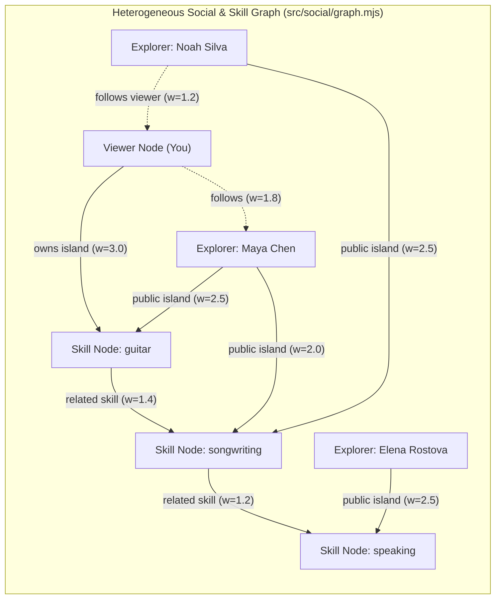

# Graph-Ranked Surrounding Neighbours & Following/Followers Individual Archipelago View

## Goal Description

Upgrade the WorldHopper **Explore** experience (`src/social/**`) with two cohesive capabilities:

1. **Graph-Based Surrounding Neighbours (5–10 Dynamic Neighbours)**:
   - Expand the pool of public/sample explorer profiles in `src/social/fixtures.mjs` to **12 diverse explorers** across guided and custom skills (Guitar, Songwriting, Photography, Japanese, Chess, Public Speaking, Visual Storytelling, Origami, Spanish Travel, Sketching, Trail Running, Synth Production).
   - Build a deterministic **Heterogeneous Skill & Social Graph Algorithm** (`rankNeighborsByGraph` in `src/social/graph.mjs`) that constructs a weighted graph of **Users**, **Skills/Topics**, **Experience Stages**, and **Follow Edges**, and runs **Personalized PageRank (Random Walk with Restart)** combined with **Adamic-Adar shared-skill weighting** seeded from the current user's islands and interests.
   - Select the top **5–10 most relevant neighbours** (default `8`) to surround the user's Home Archipelago on the shared ocean map, placing higher-similarity neighbours in closer radial sectors and displaying their graph affinity score & shortest connection path (e.g., `92% affinity · Guitar → Songwriting`).

2. **Following & Followers Section with Individual Archipelago Map View**:
   - Track both **Following** (`isFollowing`) and **Followers** (`followsViewer` / `followers` list) in `contracts.mjs`, `fixtures.mjs`, and `supabase-client.mjs`.
   - Add a **Following & Followers** section in the Explore UI (accessible both from the top filter/navigation bar and inside the Explorer drawer) listing every user you follow and every user who follows you.
   - Clicking a profile in **Following** or **Followers** (or clicking **"View solo archipelago"** on any cluster) switches the map into **Individual Archipelago Mode** (`mapMode: 'solo'`), rendering **only that explorer's islands** full-scale across the ocean canvas (using `layoutIslands` from `src/map-layout.mjs`) alongside their profile & roadmap drawer, with a one-click **"← Back to neighbourhood ocean"** button to return to the multi-cluster view.

---

## Architecture & Graph Algorithm Design

### How `rankNeighborsByGraph` Works
1. **Nodes**:
   - `user:<id>` for the viewer and each candidate public profile.
   - `skill:<key>` for each canonical skill (`guitar`, `songwriting`, `photography`, `people`, `speaking`, `language`, `visual`, `board`, `origami`, `cooking`, `coding`, `fitness`, `compass`).
2. **Weighted Undirected + Directed Edges**:
   - `user ↔ skill`: weighted by island level and whether it is an active island (`2.0 + 0.35 * level`) or declared profile interest (`1.2`).
   - `skill ↔ skill`: weighted edges between complementary skills (`1.35`) so 2-hop bridges (e.g., `Guitar ↔ Songwriting ↔ Public Speaking`) are naturally discovered even when a user has no exact 1-hop overlap.
   - `user ↔ user`: social tie edges (`1.6` if viewer follows candidate, `1.1` if candidate follows viewer).
3. **Scoring (`Personalized PageRank + Adamic-Adar`)**:
   - Run **Random Walk with Restart (Personalized PageRank)** for `20` power iterations with damping factor $\alpha = 0.82$, teleporting back to `user:viewer` (and the viewer's owned skill nodes) at each step.
   - Combine the stationary PPR probability with **Adamic-Adar similarity** ($\sum_{s \in N(u) \cap N(v)} \frac{1}{\log(1 + \text{deg}(s))}$) so rare shared custom skills (e.g., Origami or Japanese) get a stronger specificity boost than generic tags.
   - Extract the **shortest explainable path** (`viewer → skill → candidate` or `viewer → skillA → skillB → candidate`) to show a human-readable badge on each cluster and in the drawer.

---

## Proposed Changes

### 1. Graph Ranking Engine (`src/social/graph.mjs`)
- Implement `buildInterestGraph(viewerWorld, publicProfiles, options)` creating the adjacency list over `user:*` and `skill:*` nodes.
- Implement `rankNeighborsByGraph(viewerWorld, publicProfiles, { limit = 8, minNeighbors = 5, maxNeighbors = 10, viewerId })`:
  - Computes Personalized PageRank (RWR) + Adamic-Adar similarity.
  - Returns top `limit` (clamped to `5..10`) ranked neighbour entries `{ profile, affinityScore, affinityPercent, pathSummary, sharedSkills, hopCount, ring }`.
  - Assigns each selected neighbour to a spatial ocean sector around the user's Home Archipelago (closer radial distance for higher graph affinity).

### 2. Contracts, Fixtures & Supabase Client (`followsViewer` & Expanded Pool)
- **`src/social/contracts.mjs`**: Update `toPublicProfile(rawProfile, { viewerId, followingIds, followerIds, blockedIds })` to include `followsViewer: Boolean`.
- **`src/social/fixtures.mjs`**: Expand `createDefaultFixtureRecords()` from 5 to **10–12 rich sample explorers** covering Guitar, Songwriting, Photography, Japanese, Chess, Public Speaking, Visual Storytelling, Origami, Spanish Travel, and Urban Sketching. Seed initial `initialFollowingIds` and `initialFollowerIds`.
- **`src/social/supabase-client.mjs`**: Compute `followerIds` (users where `following_id === viewerId`) alongside `followingIds` in `fetchHydratedProfiles()` and pass `followerIds` to `toPublicProfile`.

### 3. Explore Map Modes (Surrounding Graph Neighbours vs. Individual Archipelago) & Following/Followers UI
- **`src/social/explore.mjs`**:
  - Use `rankNeighborsByGraph` to pick the **5–10 surrounding neighbours** for the shared ocean map based on `viewerWorld.islands` and place them in radial sectors around `HOME_CLUSTER_POS` (with affinity badges like `91% match · Guitar`).
  - Add a **Following & Followers** panel/drawer section and top toolbar buttons (`Following (N)` and `Followers (M)`).
  - Add **Individual Archipelago Map Mode (`state.mapMode = 'neighborhood' | 'solo'`)** so clicking a profile in Following or Followers renders **only that user's islands** using `layoutIslands` (`src/map-layout.mjs`), with a **"← Back to neighbourhood"** button.
- **`src/social/social.css`**: Style `.cluster-affinity-badge`, `.social-network-panel`, `.social-person-row`, and `.solo-map-return-btn`.

### 4. Automated Tests (`tests/social.test.mjs`)
- Add unit tests for `rankNeighborsByGraph` (1-hop, 2-hop skill bridges, dynamic re-ranking when viewer islands change, 5–10 neighbour bounds).
- Add UI integration tests for **Following & Followers** and switching between **Individual Archipelago Mode (`solo`)** and **Neighbourhood Mode (`neighborhood`)**.
